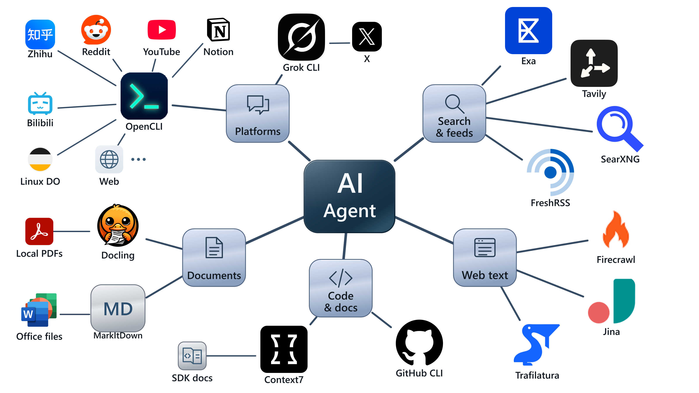

# agent-search-booster

[English](README.md) | **简体中文**

Agent Search Booster 是一个大幅增强 AI Agent 网络搜索、网页抓取与资料读取能力的 Skill。它把搜索引擎、真实浏览器、平台读取和文档工具整合成一套工作流。你只需说明想找什么、想读什么，Agent 就会选择工具，搜索来源并取得内容。

- **抓取完整网页，读取更多内容。** 从搜索摘要深入到文章正文、论坛原帖、评论和视频字幕；突破动态加载、人机验证等网页读取障碍。
- **远超单一搜索引擎的覆盖。** 结合网页搜索、平台站内搜索、X 讨论、GitHub 和技术文档，找到普通搜索容易遗漏的来源与观点。
- **分流清晰，工具自动选。** 系统的规则指导 Agent 何时调用哪种 MCP、浏览器或 CLI 工具，一条路线失败就切换合适的替代入口；无需你逐步指定工具或记住命令。

<picture>
  <source media="(prefers-color-scheme: dark)" srcset="assets/search-booster-overview-dark.png">
  <source media="(prefers-color-scheme: light)" srcset="assets/search-booster-overview.png">
  
</picture>

目前主要面向 Codex。首页提供中英双语，Skill 及调用说明使用英文；Agent 仍按你的语言偏好回复。

## 怎么用

1. 将 `skills/agent-search-booster/` 整个文件夹放入个人 `~/.agents/skills/` 或项目 `.agents/skills/`。已有同名目录先比较个人改动。[官方 Skill 说明](https://learn.chatgpt.com/docs/build-skills)
2. 对照下表确认工具已安装、连接并完成必要登录。缺项按原链接补齐；MCP 连接代码和少量必要设置见[配置要点](skills/agent-search-booster/references/setup.md)。可以先让 Agent 检查哪些入口已经可用。
3. 直接调用 Skill，无需每次指定工具或记住命令：

```text
使用 $agent-search-booster，查找 XXX 的实际使用体验。
尽量取得原帖、正文和重要评论，必要时跨平台补充来源，再整理结论。
```

工具已准备好时，用户只需交代目标和范围。Skill 中的具体调用方法供 Agent 按需读取。

## Agent 如何选择路线

- **搜索与发现**：根据问题和缺失材料组合来源。
- **网页与平台**：交互页面、登录态、动态加载或验证页面，尽早考虑 OpenCLI／浏览器读取，也适用于普通高校和实验室网站。实际可读范围取决于已有授权与网站状态。
- **专用任务**：学术检索、官方论文 PDF 下载交给相应的已安装 Skill；已有 PDF 的阅读或转换另行处理。
- **读取缺口**：区分未尝试、缺依赖和实际读取失败，核对返回内容并说明取得范围。

## 工具组合对照表

这是本方案整合的完整组件清单，用来检查是否配齐。已有对应入口可复用；备注注明补充、备选或运行组件。配齐后仍由 Agent 按任务调度，不会每题调用全部工具。

### MCP 与 API

| 工具名称 | 工具类型 | 原链接 | 工具作用 | 备注 |
|---|---|---|---|---|
| Exa | 远程 MCP / 插件 | [项目 / 文档](https://exa.ai/docs/get-started/exa-mcp) | 补充搜索来源、语义检索、指定网页读取 | 已有插件或独立 MCP 均可；同一服务不必重复接入 |
| Tavily | 远程 MCP | [项目 / 文档](https://github.com/tavily-ai/tavily-mcp) | 网页搜索、时间/域名过滤、正文抽取 | OAuth 或服务凭据；额度按账户 |
| Firecrawl | 远程 MCP | [项目 / 文档](https://docs.firecrawl.dev/mcp-server) | 网页抓取、解析和结构化抽取 | 额度敏感；按已授权入口使用 |
| Context7 | 远程 MCP | [项目 / 文档](https://github.com/upstash/context7) | 查询软件库和 SDK 文档 | 本方案使用 HTTP/OAuth；也有本地运行方式 |
| Jina Reader | HTTP 正文服务 | [项目 / 文档](https://jina.ai/reader) | 将可访问网页转换为可读正文 | 补充入口；公共 HTTP 与 MCP 分别确认 |
| Jina MCP | 远程 MCP | [项目 / 文档](https://github.com/jina-ai/MCP) | 提供 Reader 等工具的 MCP 接入 | 备选接入；按工具确认认证，历史未作为默认依赖 |

### CLI 与浏览器

| 工具名称 | 工具类型 | 原链接 | 工具作用 | 备注 |
|---|---|---|---|---|
| OpenCLI | 本地 CLI | [项目 / 文档](https://github.com/jackwener/OpenCLI) | 普通网站与平台的浏览器读取；动态/验证页面、帖子、评论、字幕 | 通用web/browser入口需Chrome、Bridge及必要的授权会话；不保证解除访问限制 |
| Browser Bridge | Chrome 扩展 | [项目 / 文档](https://chromewebstore.google.com/detail/opencli/ildkmabpimmkaediidaifkhjpohdnifk) | 连接 OpenCLI 与浏览器 | 需安装并启用；与 OpenCLI 配套 |
| GitHub CLI | 本地 CLI | [项目 / 文档](https://cli.github.com/) | 读取仓库、代码、Issue、PR 与发布资料 | 命令 gh；认证范围按任务与账户 |
| Grok Build | CLI / 辅助 Agent | [项目 / 文档](https://docs.x.ai/build/overview) | X 原帖、讨论串与补充网页研究 | 命令 grok；登录及账户额度需确认 |
| Agent-Reach | 本地 CLI / 渠道管理 | [项目 / 文档](https://github.com/Panniantong/Agent-Reach) | 辅助接通和检查各内容渠道 | 补充组件；实际读取依赖各渠道工具 |

### 文档 CLI

| 工具名称 | 工具类型 | 原链接 | 工具作用 | 备注 |
|---|---|---|---|---|
| Trafilatura | 本地 CLI | [项目 / 文档](https://github.com/adbar/trafilatura) | 从 HTML 或 URL 提取文章正文 | 适合可直接访问的文章页 |
| MarkItDown | 本地 CLI | [项目 / 文档](https://github.com/microsoft/markitdown) | Office、CSV、PDF 等转 Markdown | 按格式准备依赖；另有 MCP 版本，本方案用 CLI |
| Docling | 本地 CLI / 本地模型 | [项目 / 文档](https://github.com/docling-project/docling) | PDF 版面、表格、扫描件与 OCR | 需准备模型；复杂内容对照原页 |

### 自托管服务

| 工具名称 | 工具类型 | 原链接 | 工具作用 | 备注 |
|---|---|---|---|---|
| FreshRSS | 自托管 RSS 服务 | [项目 / 文档](https://github.com/FreshRSS/FreshRSS) | 集中读取已订阅来源的更新 | 先部署和订阅；API 读取需单独启用 |
| SearXNG | 自托管搜索服务 | [项目 / 文档](https://github.com/searxng/searxng) | 聚合公开搜索引擎结果 | 常用 Docker 部署；JSON 输出需启用 |

### 运行与配置

| 工具名称 | 工具类型 | 原链接 | 工具作用 | 备注 |
|---|---|---|---|---|
| Chrome | 浏览器 | [项目 / 文档](https://www.google.com/chrome/) | 承载 Bridge 和已有站点登录态 | Agent 使用用户实际授权的配置 |
| Node.js | CLI 运行环境 | [项目 / 文档](https://nodejs.org/) | 运行 npm 安装的 OpenCLI 等工具 | 版本按对应工具要求 |
| Python | CLI 运行环境 | [项目 / 文档](https://www.python.org/) | 运行本地抽取与文档工具 | 建议隔离依赖，避免改坏既有项目 |
| uv | 环境 / 工具管理 CLI | [项目 / 文档](https://docs.astral.sh/uv/) | 隔离安装和运行 Python 工具 | 管理工具，不直接提供搜索内容 |
| Docker Desktop | 容器运行环境 | [项目 / 文档](https://docs.docker.com/desktop/) | 运行本地 SearXNG 等容器服务 | 使用容器时 Docker Engine 需运行 |

### 协作工具

| 工具名称 | 工具类型 | 原链接 | 工具作用 | 备注 |
|---|---|---|---|---|
| AGY / Gemini | CLI / 辅助 Agent | [项目 / 文档](https://www.antigravity.google/docs/cli/overview) | 视频与相关帧分析 | 按subagent-manager专项规则；其他职责仅按用户明确请求 |
| subagent-manager | 配套 Skill | [项目 / 文档](https://github.com/LiX-Works/subagent-manager) | 管理子代理模型、交接和 Grok 额度 | 协作规则可衔接；不影响主搜索入口 |

## Agent 调用说明

| 文件 | 提供什么 |
|---|---|
| [Skill 入口](skills/agent-search-booster/SKILL.md) | 任务识别、工具分工、内容获取和交付 |
| [网页与 MCP](skills/agent-search-booster/references/web-tools.md) | 搜索补充、正文读取、Context7 和 GitHub 调用 |
| [平台读取](skills/agent-search-booster/references/platforms.md) | OpenCLI、浏览器桥、帖子、评论与字幕 |
| [Grok](skills/agent-search-booster/references/grok.md) | X 原帖、线程和深入查询 |
| [本地材料与服务](skills/agent-search-booster/references/local-tools.md) | 文档转换、OCR、RSS 与 SearXNG |
| [工具清单](skills/agent-search-booster/references/tool-catalog.md)与[配置要点](skills/agent-search-booster/references/setup.md) | 安装对照、MCP 代码与接通检查 |

Skill 统一调用方法，外部程序、服务和账户仍需准备。平台访问、认证和分页会影响实际取得范围，Agent 会说明未取得的部分；只使用已授权的免费或套餐额度。

采用 [MIT 许可证](LICENSE)。已发布版本见 [Releases](https://github.com/LiX-Works/agent-search-booster/releases)。
